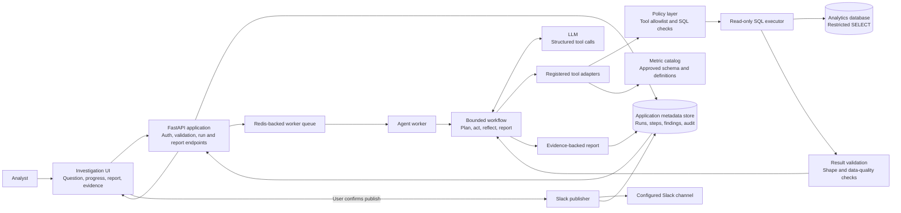

# Revenue Investigation Agent — Architecture Blueprint

## Product boundary

The application accepts a natural-language business question, investigates it against an approved read-only analytics source, and returns an evidence-backed report. The agent can plan and execute multiple bounded analytical steps. It cannot modify business data, and it cannot publish externally until the user approves the completed report.

## Component blueprint



## Trust boundaries

1. **Browser to API:** Authenticate the user, validate inputs, and authorize run access.
2. **Model to tools:** Treat model-generated arguments and SQL as untrusted. Expose only typed tools with server-enforced limits.
3. **SQL tool to analytics data:** Use a dedicated read-only database role scoped to curated tables/views. Apply independent query validation, statement timeouts, and result limits.
4. **Application metadata to analytics data:** Keep metadata writes separate from the database role used by the agent’s analytical queries.
5. **Report to Slack:** Preview first. Require an explicit, authenticated user confirmation before sending to a configured destination.

## Execution sequence

```text
1. User submits question
2. API creates analysis run and returns run_id
3. Worker loads approved metric definitions and schema context
4. Agent checks ambiguity and creates a bounded investigation plan
5. For each step:
   a. Agent requests an approved tool
   b. Policy layer validates tool arguments and SQL
   c. Read-only query executes with timeout and row cap
   d. Result validator checks shape and data quality
   e. Agent reflects on evidence and either continues, retries within budget,
      asks for input, or stops with a useful limitation
6. Report builder ties findings to validated evidence references
7. UI displays report, supporting evidence, and caveats
8. User may edit and explicitly approve Slack publication
9. Publisher sends once to a configured destination and records the outcome
```

## Suggested backend modules

| Module | Responsibility |
|---|---|
| `api/` | Authenticated run, status, report, and publish endpoints |
| `agent/` | Workflow state, step limits, planning, reflection, and report intent |
| `tools/` | Typed schema, metric, SQL, validation, and Slack adapters |
| `policies/` | Tool allowlists, SQL checks, data access rules, and run budgets |
| `data/` | Read-only analytics connection and application metadata repositories |
| `workers/` | Async run dispatch, execution, and recoverable job lifecycle |
| `models/` | Typed run, step, evidence, report, and publish records |
| `services/` | Metric definitions, report assembly, and integration configuration |
| `evals/` | Golden questions, expected evidence, and evaluation harness |

## Suggested frontend surfaces

- **New investigation:** question, date/period, metric, and optional filters.
- **Run view:** interpretation, plan, current step, query activity, retries, and errors.
- **Report view:** summary, comparison/breakdown, evidence links, confidence, and caveats.
- **Publish preview:** editable Slack message, destination confirmation, and explicit send action.
- **History:** prior runs and their status, with access restricted to authorized users.

## Operational limits for the first release

- One curated dataset and a small, explicit metric catalog
- A finite plan-step and tool-call budget per run
- At most two SQL retries per step by default
- One read-only SQL statement per execution
- Server-enforced query timeout and returned-row cap
- No SQL write operations and no model-selected connection configuration
- No automatic Slack publication
- Persisted run states and visible errors for failures that cannot be recovered

## Design rules

- Every finding should point to evidence; do not present unsupported guesses as root causes.
- Report contribution/correlation honestly; do not imply causation from a breakdown alone.
- Use the metric catalog as the semantic source of truth instead of asking the model to guess business definitions.
- Keep the first version a modular monolith with a separate worker process; split services only when independently justified.
- Make policy enforcement independent of model prompts.
